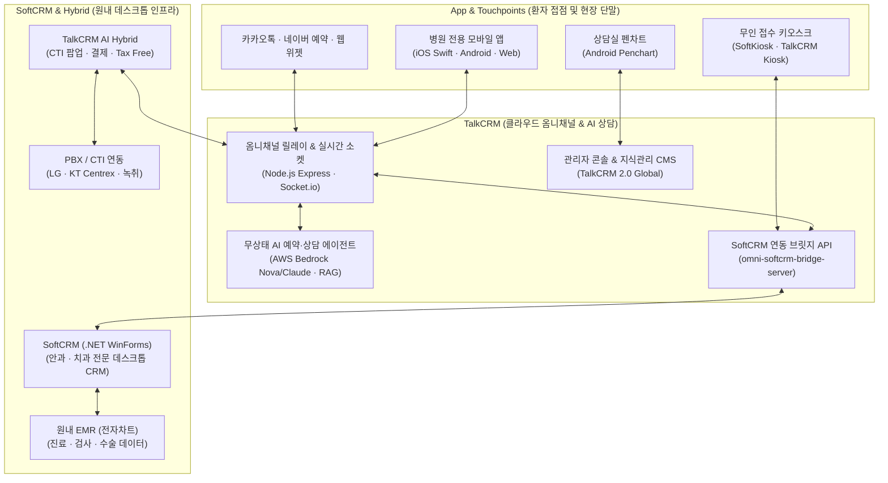

# Sungmin Networks (TalkCRM)

  
  
  
  

성민네트웍스(Sungmin Networks)는 병·의원 전문 CRM 솔루션과 생성형 AI 상담 플랫폼을 개발·운영하는 의료 IT 기술 조직이다. 환자 모바일 앱부터 클라우드 AI 옴니채널, 원내 데스크톱 CRM 및 EMR 연동까지 의료 커뮤니케이션 전 주기를 연결한다.

---

## 시스템 구성

환자 접점(App·키오스크·채널), 클라우드 옴니채널 및 AI 엔진(TalkCRM), 원내 인프라(SoftCRM·EMR·CTI)가 브릿지 및 실시간 소켓 파이프라인으로 연결된다.

---

## 핵심 제품군

| 구분 | 컴포넌트 | 핵심 기능 및 아키텍처 |
|---|---|---|
| **TalkCRM** | 클라우드 옴니채널 & AI | 카카오톡(상담톡/알림톡)·SMS·웹챗 단일 콘솔 통합 응대. AWS Bedrock(서울 리전) 기반 무상태 자연어 NLU/NLG 예약 상담 에이전트 및 의료 지식관리(KMS) RAG 파이프라인. |
| **SoftCRM** | 원내 전문 데스크톱 CRM | 전국 주요 안과 및 치과에 구축된 .NET WinForms 기반 솔루션. 원내 EMR(전자차트) 실시간 동기화, CTI(전화 인입 시 환자 차트 자동 팝업 및 녹취), 자동문자(SoftAutoMsg) 및 환자 관리. |
| **App** | 모바일 앱 & 현장 단말 | 병원 브랜드 공식 환자 앱(검사 결과, 예약, 알림 푸시), 현장 무인 접수 키오스크(Android/iOS/Windows), 상담실 드로잉 펜차트 태블릿 앱, 모바일 사전문진(마이차트). |
| **Hybrid & Bridge** | 실시간 연동 인터페이스 | 온프레미스 SoftCRM과 클라우드 TalkCRM 간 데이터 중계 브릿지, CTI 통화 연동 및 카드결제·면세환급 WinForms 하이브리드 클라이언트. |

---

## 기술 스택

- **Frontend & App**: TypeScript, Next.js, React, Swift (iOS), Java (Android), .NET Framework 4.8 (WinForms)
- **Backend & Middleware**: Node.js (Express), Python (FastAPI), Socket.io, PBX/CTI Relay
- **AI & Data Pipeline**: AWS Bedrock (Amazon Nova, Anthropic Claude), Vector DB / RAG, KMS
- **Infra & DevOps**: AWS Seoul Region (`ap-northeast-2`), Docker, Microservices

---

## 저장소 운영 정책

> [!NOTE]
> 의료법 및 개인정보보호법에 따른 환자 의료 데이터 보호와 제휴 의료기관 보안 규정으로 인해, **190개 이상의 핵심 프로덕션 코드는 비공개(Private) 저장소**로 관리된다. 오픈소스 도구 및 공개 유틸리티는 점진적으로 배포된다.

---

## 링크 및 문의

- 서비스 웹사이트: [talkcrm24.com](https://talkcrm24.com) · [softcrm.co.kr](http://www.softcrm.co.kr)
- 엔지니어링 / 기술 문의: [dev@talkcrm24.com](mailto:dev@talkcrm24.com)
- 비즈니스 / 제휴 문의: [hong@talkcrm24.com](mailto:hong@talkcrm24.com)